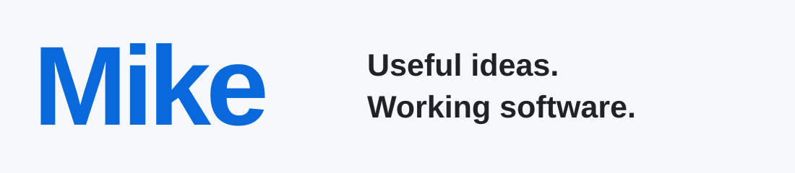

<picture>
  <source media="(prefers-color-scheme: dark)" srcset="./profile/header-original-dark.svg">
  <source media="(prefers-color-scheme: light)" srcset="./profile/header-original-light.svg">
  
</picture>

# Explore widely. Build with purpose.

[Selected Projects](#selected-projects) · [Developer Tools](#developer-tools) · [Open Source](#open-source-contributions) · [Skill Set](#skill-set) · [Activity](https://github.com/Mike-Animal-Counseling#js-contribution-activity)

## Selected Projects

Six projects spanning AI products, data workflows, cloud optimization, and developer tools.

### [PawCompanion](https://github.com/Mike-Animal-Counseling/paw-companion)

A pet companion prototype bringing character-based AI chat, pet browsing, bookings, and merchant workflows into one product. A separate scoring service tracks safety signals across rolling time windows; the checkout experience is simulated.

**Inside:** React, Express, MongoDB, and Hugging Face integrations. Persistent chat history and time-weighted scoring connect the conversation to a broader product journey.

### [Truna](https://github.com/Mike-Animal-Counseling/truna-v0)

A deployed launch verification platform I designed and built for AI-built applications. Truna turns product requirements into controlled browser checks, evidence-backed findings, and repair handoffs for coding agents.

**Inside:** TypeScript, Next.js, Express, Prisma, and Playwright. Reviewed verification plans connect browser execution with screenshots, network signals, risk analysis, and project-level launch reviews.

### [HotTopicHub](https://github.com/Mike-Animal-Counseling/hot-topic-hub)

A discovery hub that turns builder news into a daily reading list. It collects topics from sources including Hacker News, GitHub Trending, Product Hunt, Reddit, and RSS, then ranks recent items using community activity and recency.

**Inside:** React, FastAPI, and SQLite. Source caps and deduplication keep the daily list varied; optional AI enrichment has template fallbacks, with a review queue for moderation.

### [Laya × Jev](https://github.com/Mike-Animal-Counseling/laya-jev-lab)

A ticket classification toolkit that runs a fine-tuned Laya model locally or calls Jev through an API. Use the Python SDK, connect a helpdesk to the REST service, or work from a shared inbox.

**Inside:** Python, PyTorch, and Docker. Model adaptation and held-out comparison sit alongside workspace access controls, idempotent imports, and Zendesk sync. Source and Python package downloads are available.

### [CodexHalo](https://github.com/Mike-Animal-Counseling/codex-halo)

A Windows companion that keeps Codex usage limits and token activity within sight. Its floating HUD expands into daily breakdowns, history, reset reminders, and API-equivalent cost estimates.

**Inside:** Tauri, Rust, React, and TypeScript. Session history is parsed locally; the model pricing catalog updates independently and has an offline fallback. Windows installers are available.

### [LambdaOpt](https://github.com/Mike-Animal-Counseling/aws-lambda-slo-optimizer)

An AWS Lambda cost optimizer that recommends configurations against latency targets. Analyze benchmark results, CloudWatch metrics, and cold-start signals, or start with a local simulation that needs no AWS credentials.

**Inside:** Python, boto3, and CloudWatch. Cost models, Pareto analysis, and SLO risk scoring turn benchmark data into explainable configuration recommendations. Currently in beta.

## Developer Tools

### [Porter](https://github.com/Mike-Animal-Counseling/porter)

Self-hosted memory for AI coding assistants. Save project decisions and conventions, retrieve them from another tool through MCP, or export a handoff briefing.

**Inside:** Python, PostgreSQL, and pgvector, with scoped client access, an owner review inbox, and backup tools. Currently an alpha project.

## Open Source Contributions

Recently merged upstream, newest first.

<!-- UPSTREAM-PRS:START -->
| Project | Merged contribution |
| --- | --- |
| **AgentMemory** | Stop demo-owned Compose workers on Windows [#1688](https://github.com/rohitg00/agentmemory/pull/1688) |
| **Litestream** | Handle IPv6 hosts without an explicit port [#1617](https://github.com/benbjohnson/litestream/pull/1617) |
| **Pydantic AI** | Fix the Gemini command in the structured output example [#12681](https://github.com/pydantic/pydantic-ai/pull/12681) |
| **Fjall** | Track size&#95;of reads in optimistic transactions [#346](https://github.com/fjall-rs/fjall/pull/346) |
<!-- UPSTREAM-PRS:END -->

[All upstream PRs](https://github.com/search?q=is%3Apr+is%3Apublic+author%3AMike-Animal-Counseling+-user%3AMike-Animal-Counseling&type=pullrequests)

## Skill Set

| Area | Technologies |
| --- | --- |
| **Languages** | Python, TypeScript / JavaScript, Rust, Go, SQL |
| **Web, Mobile & Desktop** | React, Next.js, React Native / Expo, Tailwind CSS, Tauri |
| **Backend & Messaging** | FastAPI, Node.js / Express, Socket.IO, Redis, Celery |
| **Databases & ORM** | PostgreSQL, MongoDB, SQLite, SQLAlchemy, Prisma, Mongoose |
| **AI & Retrieval** | MCP, RAG, pgvector, OpenRouter, PyTorch, Hugging Face Transformers |
| **Cloud & Delivery** | AWS Lambda, IAM, CloudWatch, boto3, Docker / Compose, GitHub Actions, Vercel |
| **Auth & Validation** | OAuth 2.0, JWT, Clerk, Pydantic, Zod |
| **Testing & Quality** | Playwright, pytest, Vitest, Jest, Ruff, mypy, CodeQL |

[Explore all repositories](https://github.com/Mike-Animal-Counseling?tab=repositories)
