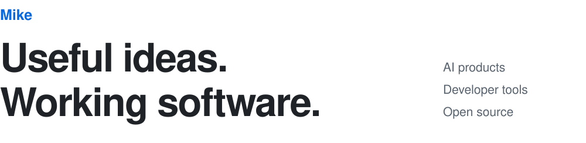

<picture>
  <source media="(max-width: 600px) and (prefers-color-scheme: dark)" srcset="./profile/header-mobile-dark.svg">
  <source media="(max-width: 600px)" srcset="./profile/header-mobile-light.svg">
  <source media="(prefers-color-scheme: dark)" srcset="./profile/header-dark.svg">
  
</picture>

## Open Source Contributions

- **Litestream** — Fixed IPv6 hosts without a port in SFTP replica URLs. [#1617](https://github.com/benbjohnson/litestream/pull/1617)
- **Fjall** — Fixed `size_of` read tracking in optimistic transactions. [#346](https://github.com/fjall-rs/fjall/pull/346)
- **Pydantic AI** — Corrected the Gemini command in the structured output example. [#12681](https://github.com/pydantic/pydantic-ai/pull/12681)

[All upstream PRs](https://github.com/search?q=is%3Apr+is%3Apublic+author%3AMike-Animal-Counseling+-user%3AMike-Animal-Counseling&type=pullrequests)

## Selected Projects

### Developer Tools

- **[Truna](https://github.com/Mike-Animal-Counseling/truna-v0)** — Verifies AI-built apps in a browser and reports what needs fixing.
- **[Codex Halo](https://github.com/Mike-Animal-Counseling/codex-halo)** — A Windows HUD for Codex usage limits, token history, and cost estimates.
- **[Porter](https://github.com/Mike-Animal-Counseling/porter)** — Self-hosted project memory shared across coding tools through MCP.
- **[AgentFocus](https://github.com/Mike-Animal-Counseling/agent-focus)** — A Windows tray app for Codex approval prompts and session handoffs.

### Applications and Infrastructure

- **[Laya × Jev](https://github.com/Mike-Animal-Counseling/laya-jev-lab)** — Helpdesk ticket classification with a local model or API and a shared inbox.
- **[PawCompanion](https://github.com/Mike-Animal-Counseling/paw-companion)** — Digital pets with authored personalities and home, walk, and café visits.
- **[HotTopicHub](https://github.com/Mike-Animal-Counseling/hot-topic-hub)** — A daily reading list built from developer news and community signals.
- **[LambdaOpt](https://github.com/Mike-Animal-Counseling/aws-lambda-slo-optimizer)** — Finds AWS Lambda configurations that meet latency targets at lower cost.

**Core stack** · TypeScript, Python, Rust, Go, Playwright, Tauri, PostgreSQL, MCP

## Activity

<picture>
  <source media="(prefers-color-scheme: dark)" srcset="./profile/stats-dark.svg">
  
</picture>
<picture>
  <source media="(prefers-color-scheme: dark)" srcset="./profile/top-langs-dark.svg">
  
</picture>

Public activity and repository languages · refreshed weekly
